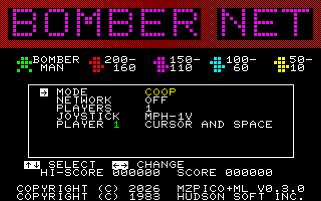
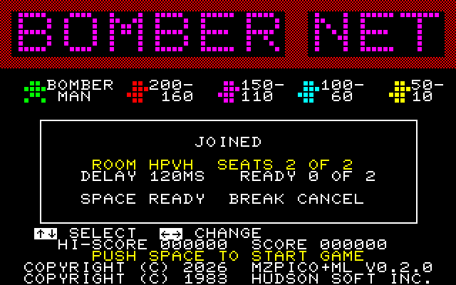
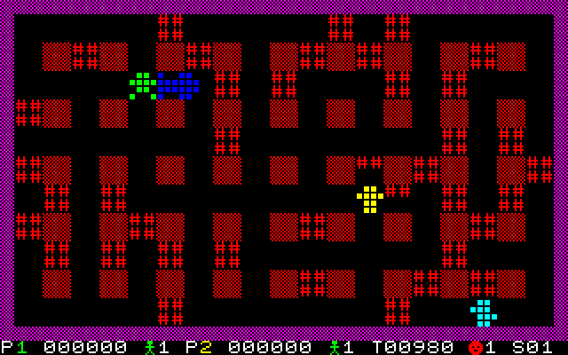

# SAPI-BomberNet

Síťový Bomberman **[BomberNet](https://github.com/MZPico/BomberNet)** pro československý počítač
**Tesla SAPI-1**. Hraje se v jedné síťové místnosti se Sharpy MZ-800 (i ve webovém emulátoru na mzpico.com),
ZX Spectrem, Amstradem CPC, PC a dalšími stroji, na které BomberNet převedli (Atari, C64, Amiga, Atari ST,
prohlížeč).

Port používá jádro hry BomberNetu beze změny (git submodul) a přidává vrstvu pro hardware SAPI-1. Síť zajišťuje
karta **[DPI-1L](https://github.com/mlukasek/SAPI_DPI-1L)** s firmwarem
[SAPI_DPI-firmware](https://github.com/mlukasek/SAPI_DPI-firmware) (Repository API a NET kompatibilní s MZPico
a Unicardem).

| Titulek | Lobby síťové hry | Zápas dvou SAPI |
|---|---|---|
|  |  |  |

*Snímky z emulátoru SAPIemu (CGA-1V, 320×200).*

## Stav

Hraje se. **Skutečné SAPI-1 s DPI-1L hraje proti emulátoru [SAPIemu](https://github.com/mlukasek/SAPIemu)**
(od verze 0.6.0, sestava `sapi1v_BomberNet`) přes produkční relay `ws://api.mzpico.com/net`, i víc zápasů po
sobě. Hra počítá stejně jako ostatní platformy (nahrávky z PC dávají na SAPI stejné hashe stavu). Zbývá vyzkoušet
web mzpico.com a další platformy. Podrobnosti: [docs/stav.md](docs/stav.md).

Jádro je **BomberNet 0.3.0** (od 2026-10-28; hraje v jedné místnosti i s 0.2.0). Nové: ESC/BREAK opustí zápas,
hráč, který položí bombu, na jeden snímek blikne v její barvě a životy hráčů jsou ve stavovém řádku v jejich barvách.

## Co je potřeba

- SAPI-1 v sestavě V: JPR-1V **s TURBO (4 MHz)**, RAM-1V, CGA-1V, MPH-1V, klávesnice Consul 262.3 nebo EKL-1,
  CP/M;
- joystick Atari na MPH-1V (doporučeno);
- pro síť karta DPI-1L s Wi-Fi.

## Ovládání

| | Klávesnice | Joystick |
|---|---|---|
| pohyb, výběr v menu | šipky (sada A), W A S D (sada B) | páka |
| bomba, potvrzení | mezera (sada A), E (sada B) | palba |
| kód místnosti | písmena, BS/DEL maže, ESC/BREAK zruší | páka (písmeno a pozice), palba |
| opustit zápas | ESC/BREAK | |
| konec do CP/M | Ctrl+C | |

- Klávesnice SAPI hlásí jen stisky: jeden stisk šipky = jedno celé políčko, další stisk během kroku přidá políčko
  nebo zatočí na dalším políčku. Na plynulé hraní je lepší joystick.
- Joystick (v menu JOYSTICK: MPH-1V, hráč: JOYSTICK MPH-1V) ovládá i menu a lobby.
- ESC/BREAK opustí zápas během hry. V síťovém zápase hra zamrzne, když se zápas přeruší během hlášky na konci kola
  (ESC, nebo když se odpojí druhá strana); pomůže jen Ctrl+C. Je to chyba jádra BomberNetu
  ([docs/stav.md](docs/stav.md), Otevřené otázky).
- Síťová hra: v menu NETWORK HOST (založí místnost, ukáže kód) nebo JOIN (zadá se kód), pak READY mezerou nebo
  palbou. Hostitel může dát READY kdykoli, hra počká na ostatní.
- V SAPIemu zapne Ctrl+F8 joystick z klávesnice PC (šipky a mezerník pak nejdou do klávesnice SAPI).

## Překlad

```
git clone --recurse-submodules https://github.com/mlukasek/SAPI-BomberNet.git
build.cmd
```

Výsledek je `build\bombnet.com` pro CP/M. Potřeba je z88dk (noční build, verze 2.4 jednu podmínku jádra
přeloží špatně), podrobnosti v [docs/vyvoj.md](docs/vyvoj.md).
Jak port funguje: [docs/technika.md](docs/technika.md).

## Licence a poděkování

Repo zatím nemá soubor LICENSE. Hra je odvozená z **Bomber Man © 1983 Hudson Soft** a jádro BomberNetu je bez
licenčního souboru. `sapi/tables.c` obsahuje dlaždice vykreslené ze znakového generátoru MZ-700 (© Sharp),
samotný generátor v repu není.

- BomberNet: Martin Matyáš ([MZPico](https://github.com/MZPico/BomberNet)), přepis hry Bomber Man © 1983 Hudson Soft.
- Hardwarová vrstva vychází z portu [SAPI-Bomberman](https://github.com/mlukasek/SAPI-Bomberman).
- Síťová karta [DPI-1L](https://github.com/mlukasek/SAPI_DPI-1L) a její
  [firmware](https://github.com/mlukasek/SAPI_DPI-firmware).
